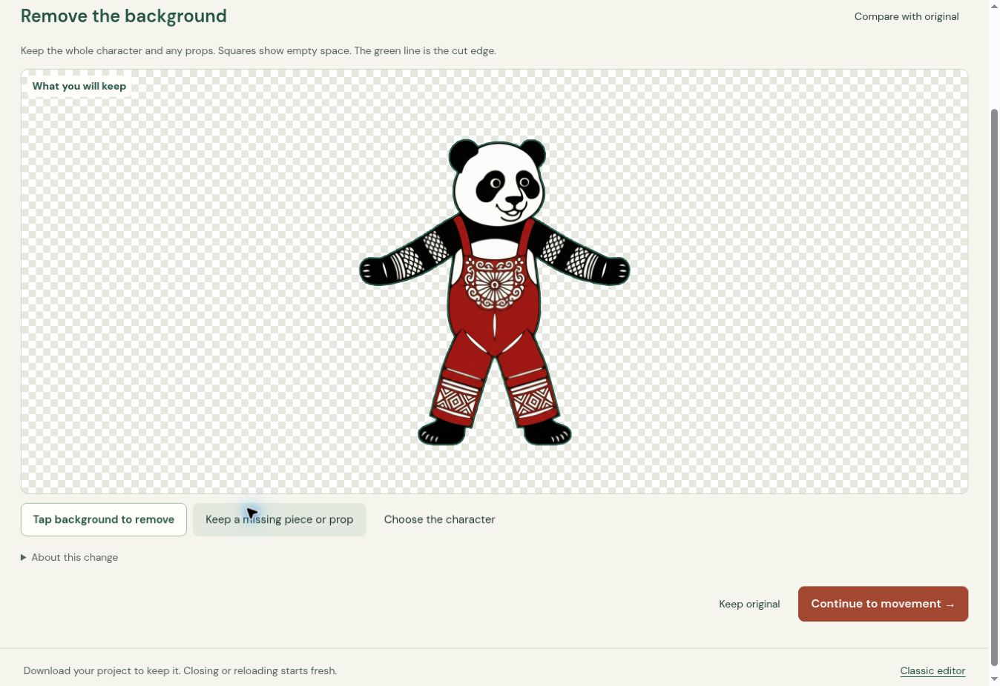
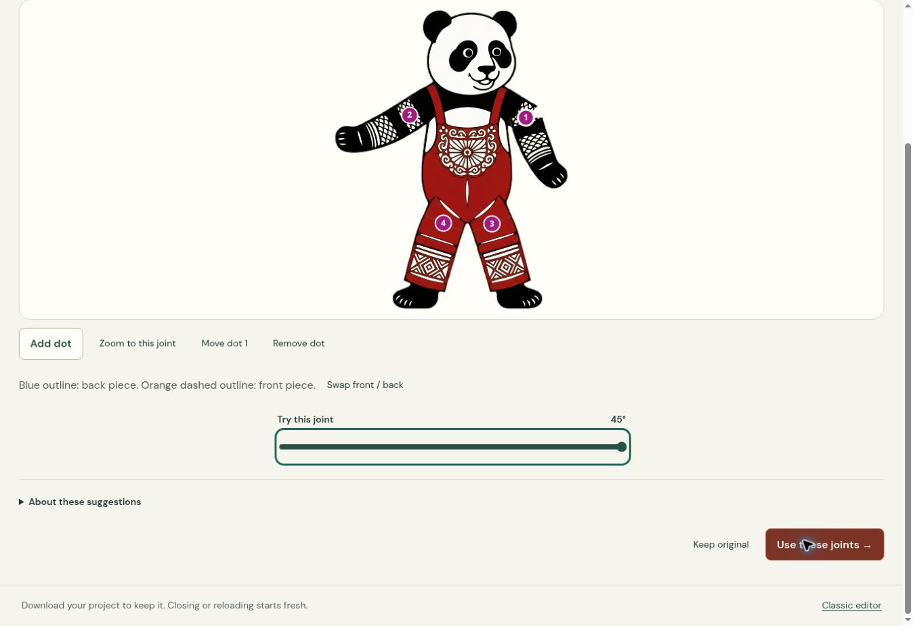
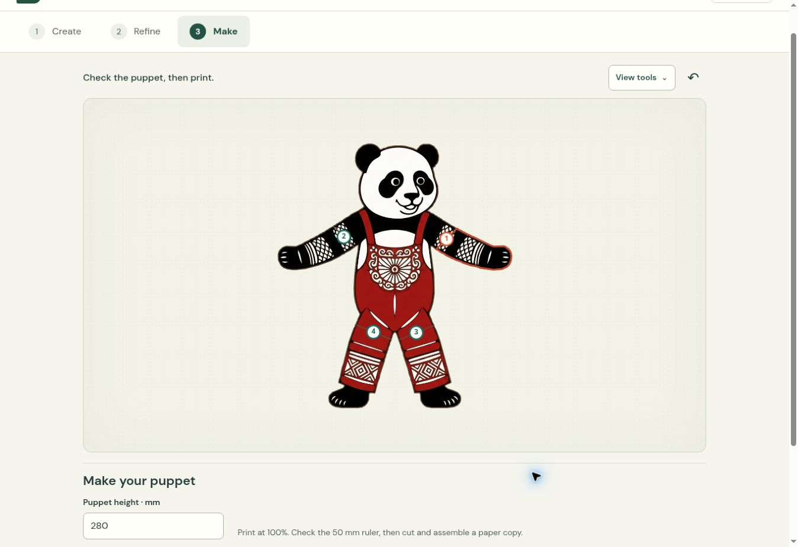
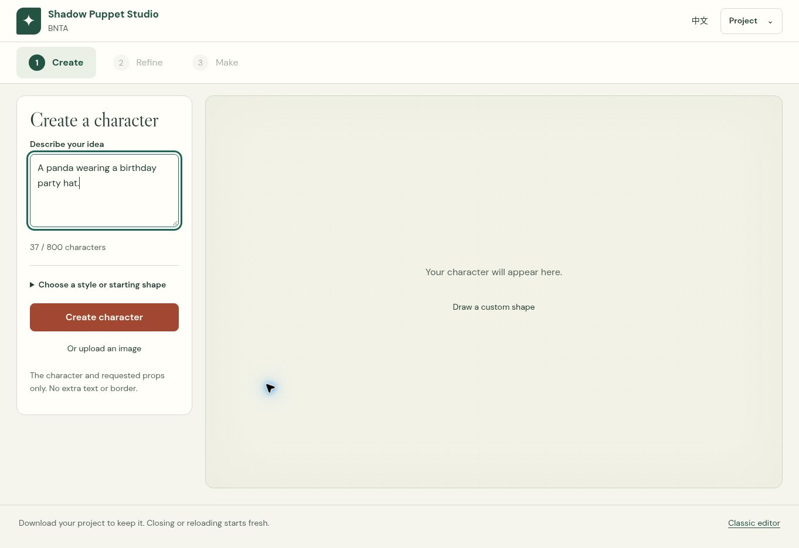
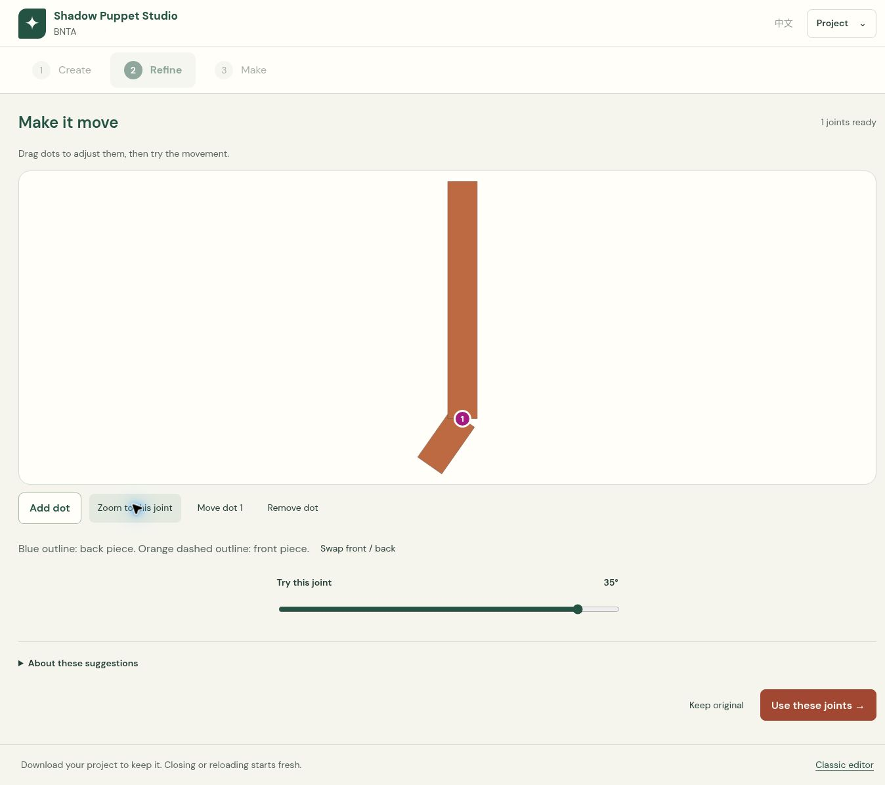
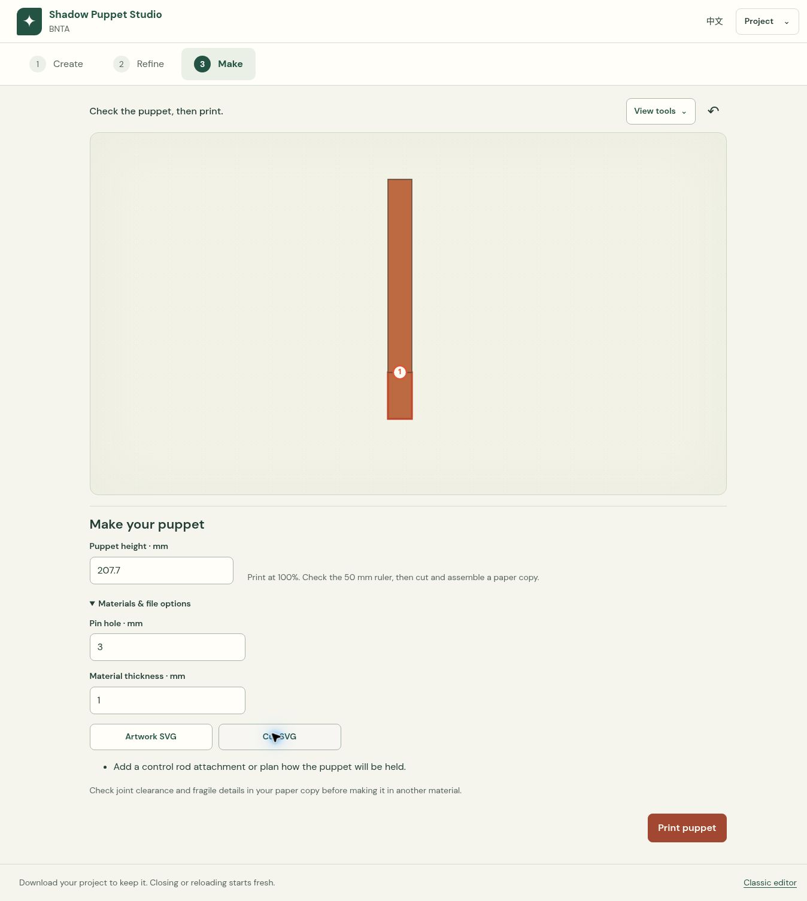
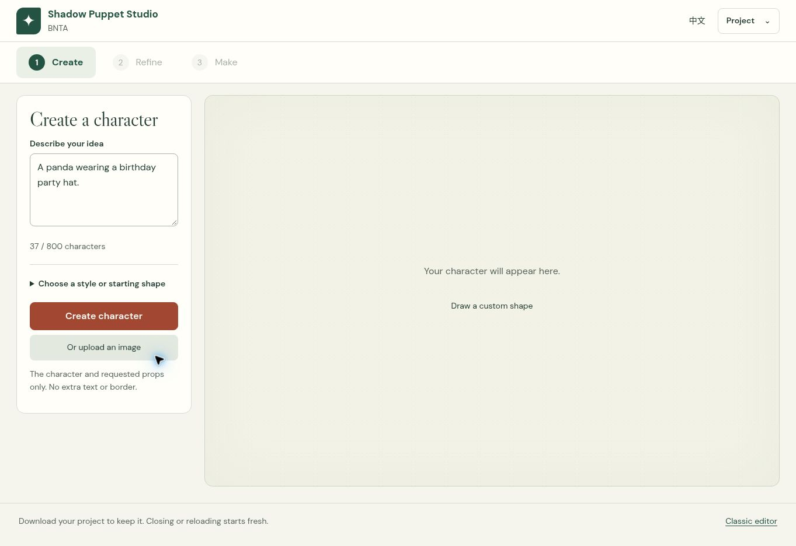
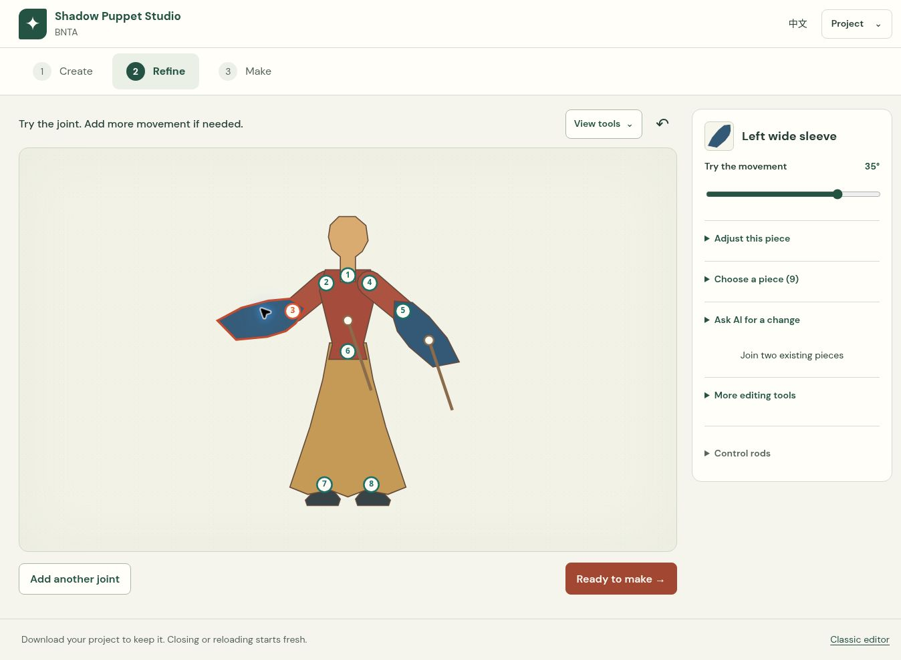
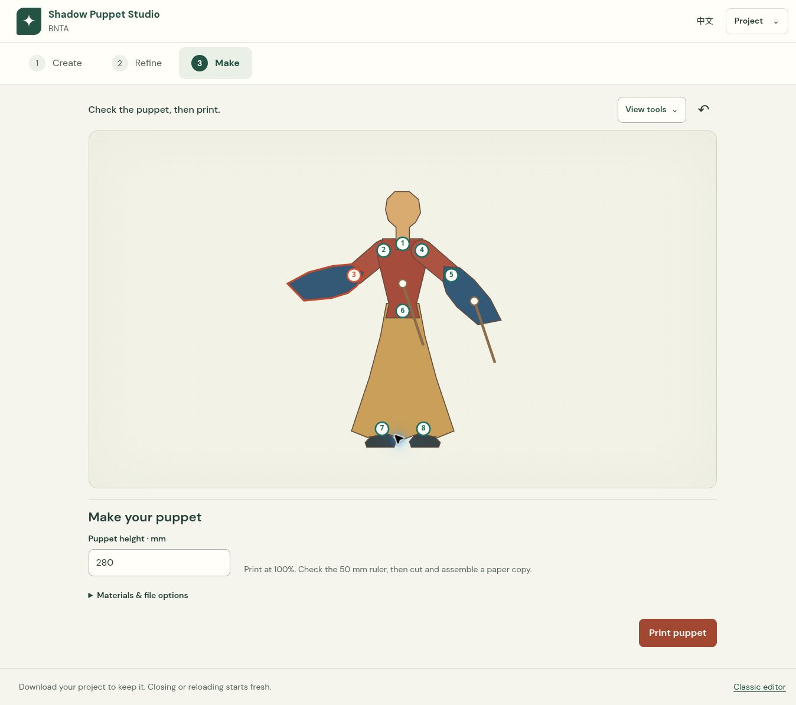
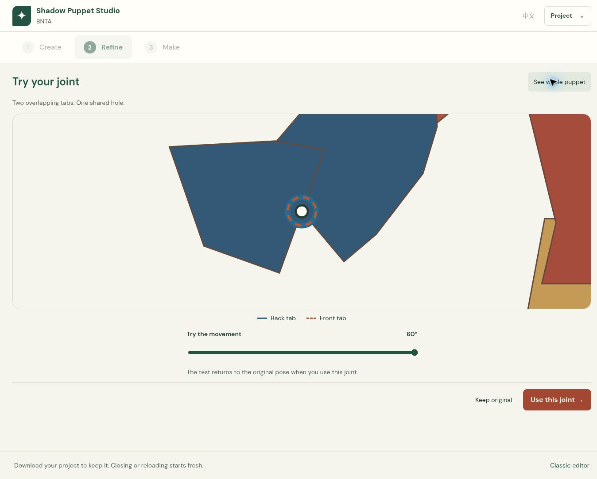

# Validation — 19 November 2026

## v0.7.10 creation choices

Style/setting tests verify all four artwork styles and three era choices reach both legacy and native image prompts, as well as editable text draft context. They preserve the student's exact description and prompt budget and do not mutate accepted artwork. Workflow tests check clearer labels, choice-specific explanations, and removal of all four starting-shape buttons. Existing test rigs now load through project import instead of the removed UI action.

These are deterministic request and interaction checks. No new live image comparison or browser/mobile layout observation was performed for this copy and control-removal update; model obedience to each visual style remains subject to image review.

## v0.7.9 student-controlled joint size

All **303 automated tests pass**. Geometry and workflow regressions cover shrinking both tabs while retaining pin holes, shared pivots, physical scale and connection topology; stable zoom during slider input and release; current-pose contact warnings; one undo per completed drag; plan rebuilds, cancellation, locks and portable project round trips. English and Chinese controls are checked outside collapsed sections. Syntax, production build, generated Worker syntax and 23-asset smoke checks pass.

The local page served successfully. Browser UI automation could not connect (Transport closed), so no new phone, tablet or student observation is claimed. Physical articulation and backlighting remain untested. Contact warnings inspect other separate pieces and their tabs, not semantic regions inside a single contour. Smaller manually chosen circles retain the original split shoulders and require movement review. Garment-layer reconstruction remains outside this update.

## v0.7.8 editable previews and printed joint overlaps

**Release checks:** the complete regression suite, module syntax, production build, generated Worker syntax and 23-asset smoke checks are required by [repository CI](https://github.com/zhinii/bnta-shadow-puppet-studio/actions/workflows/checks.yml). The final checked revision includes fixed, borrowed and clipped source artwork regressions for locked joints.

The reported Preview change failure is covered with the three actual response formats: unsupported axisAngle, negative width, and a polygon proposed as a mirror. Each receives at most one correction request for a supported mirror operation; advice-only and unchanged replies do not become previews. Direct flips preview the raster artwork and outline, keep the wrist pivot, preserve scale, and support compare, reject, apply and undo. Ignored attached-piece pose edits are rejected.

**Live protected relay:** all three [synthetic checks](validation/v078-live-revisions.json) passed on the first request: left–right mirror (10.820 s), up–down mirror (2.005 s), and 20% wider (1.798 s). Only newly authored generic vector shapes were sent. These checks establish that the deployed legacy relay can supply supported edits for these prompts; they do not establish a general success rate or test the user's basketball artwork.

[Printed joint example](validation/v078-printed-joints.svg) · [Paper prototype](validation/v078-printed-joints.html) · [Editable test project](validation/v078-printed-project.json). These are synthetic engineering specimens rendered by the application, not browser screenshots or traditional puppet designs.

**Printed overlap:** image-backed ends share source artwork from their connected pieces. Exact print is preferred, with reflected/repeated nearby print in added areas. Source alpha and pin holes are retained. The artwork mapping follows flips and dimensions; cut geometry is unchanged. Tests cover both ends, shared source pixels, taper/angle, motion, import/export, plain-color fallback, locks and bounded image embedding.

The development host disconnected after the preview tests and live checks. Tested changes were recovered from the immutable baseline and patches, checkpointed on GitHub, and then validated together with the new joint renderer. No user browser session was reset.

**Limits:** browser automation remained unavailable, so no new live browser/phone usability or screenshot claim is made. Physical paper assembly, material/translucency behavior and practitioner review remain outstanding. Copied print does not reconstruct unseen anatomy or missing costume details. Download the active project before refreshing and reopen it afterward.

## v0.7.7 full-width rounded overlaps

**Automated:** all **264 tests pass**, including **47 workflow tests**. Syntax, production build, generated Worker syntax and the 22-asset smoke check pass. Nine new geometry tests, three renderer tests and two workflow tests cover complete round ends, independent pin holes, shared pivots, affine resizing, legacy-project preservation, optional diameter controls, locks, undo and atomic rejection of invalid size changes.

New split joints use the actual section width for two completely overlapping circular ends. The renderer/export regressions use 24, 80 and 140-unit sections, straight and angled cuts, and bends from -60 to 60 degrees. They check the actual exported material contours and matching holes, not only the editing overlay. Stage, print and cut outputs use the same material geometry. Original image pixels are clipped to their own piece; the added overlap uses its editable backing color.

**Reviewable artifacts:** [before/after engineering comparison](validation/v077-rounded-joints.svg), [printable paper prototype](validation/v077-rounded-print.html), [cut SVG](validation/v077-rounded-cut.svg), [editable test project](validation/v077-rounded-project.json), and [complete test log](validation/v077-test-run.txt). Recreate these with `node scripts/round-joint-fixture.mjs`. The comparison is a deterministic engineering test shape rendered by the application code, not traditional artwork or a browser screenshot.

**Verification limits:** live browser automation was unavailable in this environment; no new live browser, phone or student usability trial is claimed. The prior v0.7.6 live journey is recorded separately below. Physical print calibration, material strength, rod control, projected overlap darkness and practitioner assessment remain outstanding. Direct outline-vertex edits display a review notice but do not recalculate stored section-width metadata. Separate-piece joining uses a geometric width estimate. Existing saved compact joints remain unchanged until explicitly edited. See [JOINT-DESIGN.md](JOINT-DESIGN.md) for the interim construction choices and next review.

## v0.7.6 background selection and middle-school recovery

**Automated:** all **250 tests pass**, including **45 workflow tests**, plus syntax, build, generated Worker syntax and the 22-asset smoke check. Four new pixel-tool regressions cover selected connected backgrounds, enclosed white artwork, disconnected props, gradients, invalid taps, remove-everything protection and transparent margins. Four new workflow regressions cover visible selection/review, cancellation/undo, suspect-rectangle gating and intentional shapes, repair from joint planning, stale results and protected pieces. A cross-module regression reproduces the retained-background knee rejection and verifies that the same knee coordinate works after actual silhouette extraction, including unioned overlap contours and matching pin holes.

**User-visible correction:** cleanup has a visible **Tap background to remove** action, source-image tap mode, Cancel, optional removal adjustment, checkerboard transparency, a green cut edge, original comparison and Undo last removal. Changes remain a draft until accepted. A suspected opaque rectangle pauses movement planning; flagged rectangular images require an explicit whole-shape choice if intentional. **Fix background** provides recovery from failed or empty image joint plans. Generated-picture approval is **Use this picture**; cleanup approval is **Continue to movement**.

The supplied panda screenshot does not contain the saved project, so its exact stored contour is unconfirmed. The regression establishes the observed failure mechanism with authored pixel data. Expert findings, implemented repairs and the remaining student-trial protocol are in [MIDDLE-SCHOOL-UX-AUDIT.md](MIDDLE-SCHOOL-UX-AUDIT.md).

**Verification limits:** the browser's file-chooser automation has not successfully populated this fixture in the app, and Chromium policy blocks DevTools/phone emulation. These are test-environment limits, not proof of an application import failure. Real phone touch, independent student use and physical assembly remain unverified.

### Published v0.7.6 desktop workflow

One fresh live test used this newly authored prompt (204 / 800 characters):

> A panda wearing red overalls, standing upright as a simple shadow puppet. Two arms held away from its body and two separated legs. Bold black outlines and flat colors on a plain white background. No text.

Generation returned a panda with red overalls, two separated arms and legs, and no visible text. **Use this picture** opened **Remove the background** with focus on the heading. Automatic cleanup displayed checkerboard transparency and the actual green cut edge. **Tap background to remove** opened the original-image view with the short tap instruction and Cancel. Clicking the white space produced a review with the surrounding background removed and enclosed white face/clothing details retained. The browser input call timed out, but the following state inspection confirmed the completed removal and **Undo last removal**. Undo returned to the preceding cleanup proposal.

**Continue to movement** produced four geometrically valid proposed joints. The selected arm visibly rotated to 45° using **Try this joint**. **Use these joints** committed five pieces/four joints; **Ready to make** reached the height and print screen. This establishes one successful generated-image → cleanup → background tap/undo → joint review/movement → Make journey. It does not establish anatomical accuracy for arbitrary characters or a general success rate. Printing/export was not repeated in this live v0.7.6 check; earlier output checks remain separately recorded below.

## v0.7.5 continuation checks

**Automated:** the final v0.7.5 run passes 241 tests, including 41 workflow tests (14.74 s). Syntax checks, the production build and Worker smoke checks also pass. Six new geometry regressions cover selected subsets and reversed branch order, original-torso rejection, unchanged manual placement, a long-robed figure, a footballer with an unlocked separate ball, and a six-tentacle silhouette. Four new workflow regressions cover delayed capability checks, endpoint/session races, empty-plan recovery, and 44 CSS-pixel marker targets at 366/820/320 px widths. These are event/geometry checks, not real touch-device observations.

**Live synthetic relay:** [the recorded run](validation/synthetic-joint-relay-2026-11-17.jsonl) passed 3/3 cases: one lower bend (6.299 s), one left bend (3.106 s), and no joints for an explicitly still puppet (2.229 s). Only newly authored literal rectangles and generic test instructions were sent; no uploaded image or user project was used. The earlier blocked project-data request was not repeated. These checks establish the structured selection contract for simple shapes, not real-character anatomy or a general success rate.

The first still-puppet test failed because the provider returned correct advice in prose without selectedIds; the client correctly refused to treat prose as a machine selection, then offered geometry fallback. Adding an explicit empty-selection JSON example produced a valid zero-joint response in the targeted retest and the final three-case run. Prose is still never converted into guessed joints.

A nine-branch synthetic outline exposed threshold dependence: the same branch represented 25.95% of the original figure but 35.05% after an earlier cut, triggering the 35% broad-cut guard. Batch construction now evaluates the same finite cut against the immutable source contour. Current-fragment validity, minimum area, pin spacing, locks and the 90 mm cap still apply. No all-pairs trial loop was added; the existing 80-dense-contour performance regression remained below one second locally.

A further live check exposed irrelevant image-cleanup controls beside a blank drawing; drawing now uses the full canvas with its existing Finish, Cancel and Undo point controls, and the inspector returns after finishing. The existing drawing workflow regression covers this change.

UI fixes let blank joint artwork scroll vertically, reserve touch dragging for dots, recompute marker hit areas after layout/resizing, and provide an Add your first movement point action when no dots exist. Creation now waits for a confirmed service capability and allowance instead of offering a transient text-draft route. Connection responses are scoped to their endpoint and session.

### Published v0.7.5 startup check

After deployment, reloading cleared the synthetic project and returned to Create with Refine/Make disabled. The page initially showed Connecting and a pending allowance, then enabled Create character. The exact prompt `A panda wearing a birthday party hat.` displayed **37 / 800 characters**. No generation request was submitted in this check.

### Live v0.7.4 browser workflow

A newly authored synthetic test used a plain vertical paper strip and requested one lower bend. After drawing the rectangle, **Prepare joints** returned one near-bottom dot; **About these suggestions** confirmed AI selection. The test then removed that dot, used **Add your first movement point**, and placed a replacement near the bottom. It produced one reviewed joint.

The selected joint was inspected in close-up and moved to 35°. Swapping front/back rebuilt the proposal and reset the trial angle to 0°; after setting 35° again, switching to the whole-puppet view retained that angle. Accepting committed the original 0° resting pose. **Ready to make** reached Make. The prepared print document contained two labelled piece pages, matching #1 holes, Layer 1 at the back and Layer 2 at the front, a 50 mm calibration ruler and overlap assembly instructions. The Cut SVG download completed. The [downloaded SVG](validation/v074-synthetic-cut.svg) parsed successfully and contains two `data-cut="outline-and-holes"` paths, each including its rounded overlap tab and matching circular hole subpath. Its scale is 0.28 mm per artwork unit; the hole radius of 5.35714285714 units gives a 3 mm pin-hole diameter. This verifies the synthetic drawing → AI plan → local correction → movement review → print-document/export journey and the exported hole geometry; it does not verify an operating-system print dialog or a physical print.

Deleting the last dot exposed misleading text claiming that no suitable automatic joints had been found, despite the earlier valid AI suggestion. v0.7.5 removes that duplicate body text and retains the neutral empty-state instruction and actions. It also changes the singular count to **1 joint ready**. Existing workflow regressions now cover both an initially empty AI selection and deletion of the final suggested dot. These final copy changes are automated-test verified; the screenshots below were captured on v0.7.4 before that polish.

No fresh image-generation or file-upload test was performed in this continuation. The relay still uses prompt and outline measurements for joint planning; the synthetic strip checks do not establish anatomical selection on realistic artwork. Phone/tablet touch, independent student use, physical assembly and printed calibration remain outstanding.

## Previous v0.7.3 automatic joint planning

The new default chain is generated-image acceptance or first artwork upload → cleanup review → cleanup acceptance → automatic joint-plan review. Existing pieces are not silently rebuilt when a new image arrives. Each cleanup and plan still requires its own explicit acceptance; automatic progression prepares the next proposal rather than committing it.

The plan presents numbered dots with add, move, remove, drag and keyboard adjustment. The selected joint shows both overlap layers and can be tested in a temporary preview. Its front/back order can be swapped and retained while the plan is rebuilt. Edits rebuild from the original pre-plan geometry, and do not make further AI calls. All invalid dots must be corrected or removed before the plan can be accepted. One acceptance commits the entire plan in one undo step, preserving the resting pose. A plan with no remaining dots can continue as a still puppet.

AI chooses only from bounded, measured local candidates. The current protected relay uses the student's brief and outline data, not image pixels. A live horse-planning request returned a valid selection of the supplied neck and foreleg candidates in **8.176 seconds**. That single request establishes a working selection contract; it does not establish visual recognition, anatomical accuracy or a general success rate. Provider failure, timeout and invalid selection fall back to explicitly labelled local geometry suggestions; cancellation must not install a fallback.

Magenta mark detection runs locally during planning; black detection is explicitly requested because eyes, buttons and decoration are ambiguous. Detection keeps source pixels intact. Embedded marks remain in exported artwork; editing-overlay numbers are not painted into the image. Geometry checks govern whether any detected mark can become a joint.

**Recorded v0.7.3 verification status:** 231 automated tests pass, including 37 workflow tests. Syntax checks, the production build, generated Worker syntax and the 22-asset Worker smoke checks pass. Live generation, subject cleanup and a three-joint review were observed on the preceding v0.7.1 build. That test revealed incorrect semantic choices and the wide-neck limit, which v0.7.2 addresses in code and regressions. The batch close-up and revised AI selection are not claimed as fully browser-verified. A live v0.7.2 local starter test passed piece selection, 35° sleeve motion, Make, print-document preparation with all eight numbered connections, Cut SVG download and a blank reload. The downloaded SVG parsed successfully (nine cut paths; millimetre dimensions). The operating-system print dialog and physical print were not verified. A malformed settings URL exposed a raw browser error, fixed in v0.7.3. A final live v0.7.3 check confirmed readable HTTPS guidance, Escape recovery and successful error dismissal, the exact panda prompt counter at 37 / 800, and preserved local-starter selection/motion at 35°. Browser file-chooser automation repeatedly stalled; current live import, phone/tablet touch, independent student use and physical assembly remain unverified. Automatic approval review rejected an additional live Kimi planner request on project-data transmission authorization grounds; it was not repeated.

### Real generated horse regression

The live generation/cleanup journey produced a 399-vertex horse but initially found no automatic joints. Infinite-line checks were crossing unrelated limbs and mane details. v0.7.2 uses the finite interior section containing each proposed dot, preserves both original contour arcs and rejects invalid or area-changing cuts. Manual whole-line splitting retains its original behavior. The exact image-free outline is retained in `tests/fixtures/generated-horse-outline.puppet.json`. With a 12-candidate budget, a bounded set of valid candidates includes the upper neck/head and front legs; all replay successfully, with unchanged area (296322 artwork units²), artwork associations and physical scale. Keeping large artwork payloads out of repeated geometry copies reduced this fixture’s full-image plan build from about 3.65 seconds to 268 milliseconds in the development environment. These are measured local results, not mobile performance claims.

### Recorded v0.7.2–v0.7.3 interface evidence

The Create screenshot verifies the v0.7.3 prompt counter without submitting a generation request. Refine shows the v0.7.3 local construction starter, not AI-generated artwork. The Make screenshot records the v0.7.2 print/export check; that workflow is unchanged in v0.7.3.

## Previous v0.6.1 joint workflow verification

The v0.6.1 change replaced the default two-point cut with **Add a joint → tap once → Try your joint → Use this joint**. A local geometric search proposes a narrow cut, a shared pivot, reinforced overlap on both pieces and an initial front/back order. Joining existing pieces takes one tap on each piece and proposes their anchors automatically. Manual two-point cuts and two-anchor placement remain advanced tools.

Joint review opens with a close-up of the shared pivot and can switch to the whole puppet without changing geometry or the trial angle. It distinguishes the back tab with a solid blue outline and the front tab with a dashed orange outline. Its range slider changes a preview copy; accepting a joint retains the original resting pose. Front/back swapping is explicit. Both printed pieces retain their actual unioned material tabs and matching circular holes; guide annotations are not extra cut lines. The assembly guide names Back and Front for every connection and explains aligned holes and loosely fastened paper pins.

Focused renderer checks passed for material extending across both sides of a split, identical reinforced contours in stage/artwork/print outputs, matching pivot centres through rotation, deterministic layer order, and review annotations excluded from exports. **The integrated v0.6.1 run passes 186 automated tests, including 26 workflow tests. Syntax checks, the production build and Worker smoke checks also pass.** Live desktop browser checks passed for one-tap sleeve placement, preview rotation to 60°, front/back swapping, acceptance returning to the original 0° pose, Make, printable HTML preparation and Cut SVG download. The printable connection guide matched the swapped layer order. Reloading started a blank session. The final close-up and whole-puppet toggle were visually checked, including retaining the 60° trial angle while switching views. No new live image-generation result, phone/tablet usability result, physical prototype or visible operating-system print dialog is claimed here.

The search is geometric, not anatomical. It rejects unsuitable sections instead of inventing disconnected pieces. Numeric limits and clearances are paper-prototype heuristics, not certified material standards. Original artwork is retained; hidden surfaces are not reconstructed. Motion preview remains planar and does not test collision, stiffness, fastener thickness or rod control.

## Previous v0.5.1 automated checks

**Recorded v0.5.1 verification: 173 automated tests passed, including 22 workflow tests.** Syntax checks, production build and Worker smoke checks passed with 19 public assets. Reproduce with npm run check, npm test, npm run build, and node scripts/smoke.mjs.

Coverage includes arbitrary image-backed polygons; branched and chained connections; exact pivot coincidence under rotation; physical scale independent of pose; pin holes and united overlap tabs; invalid outlines and overlapping holes; locked parts and their ancestors; selected-piece AI edits; exact custom prompts; malformed, truncated and advice-only responses; one bounded AI repair; protected multimodal payloads; image retrieval and visual comparison; origin/request limits; secret exclusion; portable image round-trips; and the three-stage UI event workflow. Legacy IndexedDB transaction utility tests remain, but the application no longer saves projects through those utilities.

The workflow suite covers the complete sequence: generated artwork and custom prompt/preset transport; review, discard and acceptance; local silhouette extraction; splitting with a hinge; adding a control rod; manual width changes and a selected-piece natural-language length revision; proposal acceptance, undo/redo and joint posing; artwork/cut SVG export and print HTML preparation; and explicit project download/import with artwork, dimensions, connections and rods preserved. The generation route uses controlled relay responses and real PNG pixel fixtures in a DOM/canvas double. Text revisions send numeric geometry without image bytes, and local construction/export operations make no additional AI POST requests.

Additional fixtures cover background-removal review, preserved originals and locked artwork, color-region selection, direction selection, attached-piece motion, stale proposals, and selection/import tool resets. Regressions ensure advice-only drawing responses remain visible without an Accept action, Enter/Space activate advertised SVG part/joint controls, keyboard selection requests focus restoration, and clicking a joint opens its child's movement controls without altering geometry. These tests verify event wiring and explicit file round-trips, not actual browser focus, touch interaction, rendering or printing.

Model tests verify stable physical scale when adding, removing, splitting and resizing parts, including a small first piece. Raster tests check enclosed white regions, concave boundaries, disconnected pieces and rejection of unsupported opaque/complex outlines. Renderer regressions verify one closed reinforced boundary at four image resolutions and exact circular pin-hole diameters after artwork deformation. The split/export flow initially exposed a sub-unit segment tolerance defect; it was fixed and is now covered.

The build links modules into isolated scopes, syntax-checks the generated Worker and portable application, and serves both classic and new assets. Smoke tests cover the public assets, both API status routes, CORS preflight, foreign-origin rejection and missing resources.

## v0.5.1 prompt-budget and Create feedback hotfix

A short panda description exposed a route-specific mismatch: the v0.5 adapter expanded 37 characters of student text to a 1,335-character prompt after adding internal generation rules. The known legacy image client limits the complete `/api/puppet/image` prompt to 800 characters, and the service returned the raw error code `prompt`.

The hotfix budgets the entire legacy image prompt at 800 characters. It preserves the exact student text and selected settings; compact internal image guidance is optional and uses only the remaining budget. An oversized required prompt is rejected locally before an image POST rather than truncated or sent with missing choices. The optional v2 route and text-design input retain their 4,000-character limit.

Create now uses the applicable input limit, always shows a live character count and the budget remaining after selected settings, and places request progress/errors inside the form near its action button. The current automated run records prompt-budget, non-truncation, selected-preset and feedback regressions together with the retained session, geometry and lock tests. These are controlled response/event tests, not actual provider acceptance or rendered accessibility evidence.

A network attempt to verify the panda timed out before any HTTP response. No fresh image was returned or assessed. Earlier successful generation trials below remain historical evidence; they do not demonstrate that the 0.5.1 payload or UI has passed a live generation check.

## Previous v0.5 interface and fresh-session revision

The v0.5 implementation keeps **Create → Refine → Make** and replaces the required four-substep Refine navigation with one next action. **Remove extras** proposes the largest connected foreground region after plain-background cleanup. Review can keep additional separate pieces/props or select a different main region. The default review shows the result with an original/result toggle and a clear accept/keep-original choice; a three-way comparison is no longer the default.

**Add movement** opens the two-point split tool. The accepted joint has a compact angle control, with another joint available when needed. Detailed piece controls, image tools, AI dialogue and view tools are collapsed. Make leads with print height and printing; material/file settings remain optional. The UI tests cover these event routes and retain earlier session, lock, review, viewport and export regressions.

These are implementation and automated-event checks. They do not establish actual browser layout, mobile usability, focus behavior, touch precision or print-dialog behavior. No newly rendered screen, mobile or physical-print evidence is available for this revision.

Remove-extras fixtures exercise largest-component selection, manual subject selection and retention of additional disconnected regions. The operation follows pixel connectivity rather than recognizing a person, puppet, prop or anatomical part. Connected decoration remains; separated intentional details require review. Rebuilding pieces has a visible replacement warning and respects locks.

The generation contract preserves the exact custom prompt and selected settings. On the legacy image route, optional compact instructions against unrequested text, stars and borders fit only into the remaining 800-character total budget. V2/text inputs retain the separate 4,000-character limit. No new image output was obtained for the hotfix; prior provider trials remain historical evidence.

Both current and classic editors now keep projects only in the open session. Reloading/reopening starts fresh, including browser back/forward restoration. Explicit Download/Open is the continuation route. The AI endpoint preference remains separate from project content and persists. Former v2 IndexedDB and v1 localStorage project snapshots are cleared best-effort; blocked storage cannot stop the editor and unrelated settings are untouched.

Focused verification completed so far: **12 storage tests** pass, including cleanup success, absent/blocked/error cases and bounded timeout; **21 classic/model/redesign tests** pass, including no automatic restore/write, only the known v1 key being cleared, explicit Download/Open, a fresh second initialization and a back/forward restart request. The current editor's session, review and viewport regressions also pass in the integrated run. These use simulated browser events; no actual window reopening or focus behavior is claimed.

## Working image relay checks

The new editor now calls the existing protected `POST /api/puppet/image` route with `{application,kind:"reference",prompt}`. Three real image-generation requests returned PNG data URLs and identified `wan2.7-image-pro`. A prior capability check timed out before sending the footballer request; retrying with the already verified capability succeeded. The browser now reuses its checked capability while making a request rather than repeating that preliminary network check. A subsequent live capability check correctly reported generation available, editing/vision unavailable.

Two outputs were retained and inspected, and were tested through the new adapter and local geometry tools:

| Prompt | Image response | Visible result | Local construction result |
| --- | --- | --- | --- |
| Blue/yellow footballer with separate ball | 1024×1024 PNG, about 52 seconds | Main costume, two arms/two legs, running pose and separate ball present | Background cleanup found figure and ball; split/hinge, pose, resize and artwork/cut SVG export passed |
| White-coated scholar with exactly six tentacles | 1024×1024 PNG, about 54 seconds | **Failed count:** eight visible tentacles, only one visible human arm | One connected silhouette; geometry-only split, hinge, pose, resize and both SVG exports passed |

The first long-robed scholar request established the live route and PNG response but was not retained for visual assessment; no fidelity claim is made for it. These are small concrete trials, not a general success-rate estimate.

The real image trials used a Node PNG header reader for the adapter, followed by independent System.Drawing pixel decoding for local extraction. Browser image decoding/resizing and UI acceptance are covered by DOM-double tests, not live browser automation. Sampled costume, face and ball pixels stayed unchanged after background cleanup. Physical scale remained unchanged through pose and resizing. Several unsuitable footballer split lines were rejected before a valid simple cut succeeded; the UI now explains that the line must cross one narrow section twice.

Generation is separate from automatic visual evaluation. Returned artwork must be reviewed for anatomy, counts, costume and props; the current review asks students to check limbs, costume and requested props. Editing and vision remain disabled for the generation-only route. No provider credential is exposed and no paid generation call is automatically retried. The Kimi share link supplied by the user yielded only a public app shell; its full handoff text could not be read, so the integration is based on the verified live contract and repository client.

## Earlier live AI checks (before the local image-tools work)

The existing protected service responds at `/api/status` and reports a configured Qwen provider. Real requests tested a footballer with a separate ball, a long-skirt figure with wide sleeves, and a white-coated character with exactly six tentacles.

Early tests exposed instruction conflicts, advice-only responses, zero-area details and crossed ornamental boundaries. The client was refined to preserve the exact request, extract only parseable measurement data, validate complete geometry, and make one correction attempt. The service still retains the old fixed-character system prompt, so compatibility results are not a guarantee that arbitrary prompts will succeed.

The final repeated creation trial returned **3 structurally valid drafts out of 6 requests**: one footballer and two skirt designs. One footballer request timed out. Both tentacle cases still had invalid geometry after the repair and were rejected. This small trial measures structural validity, not visual fidelity or a general success rate. A separate live selected-sleeve revision passed and changed only that selected part.

At that earlier stage, `/api/studio/status` returned **404**, and the new image endpoint had not been deployed on the protected Kimi host. The local environment had no configured provider credential. Image analysis/generation/editing/evaluation tests then used controlled provider responses and established protocol handling only. They did not establish account authorization, output quality or actual live vision; the later real generation trials are documented separately above.

The initial local image-tools release made no live generation requests. The later bridge described above connects Kimi's now-working image route while preserving its classic client. The provider service and model selection are unchanged. Placeholder replacements for the classic app and CSS were restored, and a later syntax typo was repaired.

## Remaining verification

- Earlier browser-control attempts returned `Transport closed`, and the previous audit could not establish rendered usability. v0.6.1 has the historical live desktop observations recorded above; the new v0.7.2 automatic interface is awaiting browser verification. Actual phone/tablet interactions, focus behavior and print dialogs remain separate checks; source tests do not establish them.
- Physical material strength, hole clearance, layered movement, light transmission and rod control require a prototype with the chosen material.
- Add and verify vision/image-editing capabilities separately. Test automatic image critique and selected-region revisions before advertising them. See `integration/IMAGE-HANDOFF.md` and `integration/STUDIO-V2-RELAY.md`.

GitHub Pages publishes the browser application; its successful deployment does not deploy or certify the separate AI service.

The final workflow checks include centred zoom and bounded zoom levels; panning without geometry changes; pointer capture, unrelated-pointer rejection and cancellation; 44-pixel vertex hit regions; keyboard and Shift nudges with stable physical scale; pending-review edit isolation; and a cancelled older AI request completing after a new session starts. Open panels and focused controls are preserved across rendering. Reset also clears the print iframe and transient notices. The earlier v0.6.1 desktop joint flow was checked as recorded above; the v0.7.2 automatic flow awaits browser verification; physical operation and phone/tablet interaction remain unverified.
